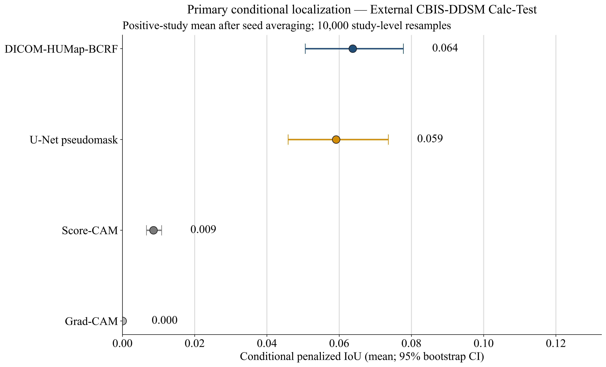

# Mammo-BCRF

**Box-supervised calcification localization in DICOM mammograms.**

This repository contains DICOM-HUMap-BCRF: a multiscale heatmap model with learned reliability fusion, bounding-box-derived center/size/offset targets, presence and count heads, and an experimental residual-risk map. **HUMap denotes Heatmap–Uncertainty; HU does not mean Hounsfield units.**

## Datasets and experimental roles

### VinDr-Mammo v1.0.0: development and internal retrospective evaluation

[VinDr-Mammo v1.0.0 on PhysioNet](https://physionet.org/content/vindr-mammo/1.0.0/) contains 5,000 examinations and 20,000 full-field digital mammography DICOM images from two Vietnamese hospitals, collected in 2018–2020. Each examination contains left/right CC and MLO views. Independent double reading and arbitration support breast-level assessments and finding-level bounding boxes. The official split contains 4,000 training and 1,000 test examinations. See the [dataset publication by Nguyen et al.](https://www.nature.com/articles/s41597-023-02100-7).

**Access is restricted.** Files require a PhysioNet account and acceptance of the dataset Data Use Agreement. Obtain data from the original provider; raw images and annotation collections are not distributed here. See the [current access terms](https://physionet.org/content/vindr-mammo/view-dua/1.0.0/).

The experiment used a **locally available, bbox-selected abnormal cohort**, comprising **1,622 images from 885 studies**, with **2,088 finding-level boxes**. The target category in the frozen local annotation snapshot was `Suspicious Calcification`: **402 images, 207 studies, and 499 target boxes**. Images containing other annotated findings were non-target controls. This cohort is not a population screening sample, and these controls must not be described as normal mammograms.

All 2,088 boxes underwent geometric checks: none had non-positive dimensions; 26 required clipping to image boundaries, including two target boxes. Finding-level boxes supplied center-density maps, center locations, relative size, sub-grid offset, presence, and count targets. They did not supply presumed calcification contours or expert pixel-level segmentation masks. Breast density, manufacturer, and view metadata characterize the cohort; they are not additional BCRF inputs. Training-only whole-breast intensity/texture/morphology measurements are exploratory analyses, not a numerical radiomics input branch.

Partitions were formed by `study_id`, with seed **342**, selected using pre-model balance criteria. Available identifiers establish study-level separation; patient-level separation is not established.

| Partition | Images | Studies | Target-positive images | Target boxes | Role |
|---|---:|---:|---:|---:|---|
| Train | 745 | 401 | 177 | 219 | Parameter fitting and development ablations |
| Validation | 182 | 101 | 42 | 54 | Checkpoint selection and development localization |
| Calibration | 183 | 101 | 40 | 60 | Presence threshold after localization freezing |
| Internal retrospective (`locked_test`) | 183 | 101 | 44 | 57 | Historically inspected retrospective evaluation |
| Secondary-source test | 329 | 181 | 99 | 109 | Historically exposed retrospective subset |
| **Total** | **1,622** | **885** | **402** | **499** | |

The name `locked_test` is retained in stored results for compatibility; it does not establish an untouched confirmatory test. The secondary-source subset has a separate historical role and is not part of the three-way model-comparison results below. Counts are available in [dataset_summary.csv](dataset/dataset_summary.csv); the frozen roles are recorded in [split_protocol.json](dataset/protocol/split_protocol.json).

### CBIS-DDSM Calc-Test: frozen external-source localization

[CBIS-DDSM on TCIA](https://www.cancerimagingarchive.net/collection/cbis-ddsm/) is a curated DICOM version of scanned-film DDSM mammography, with full mammograms, ROI/cropped images, annotations, and pathology information. The collection includes 753 calcification cases and 891 mass cases; see [Lee et al., Scientific Data (2017)](https://www.nature.com/articles/sdata2017177). TCIA lists 151 subjects for the Calc-Test description and distributes the collection under CC BY 3.0 with required attribution.

Only **Calc-Test** was used here: **151 participants, 284 full mammograms, and 326 reference calcification regions**. Full mammograms were the only image inputs. ROI masks were used solely to derive reference boxes: choose a mask-like series, identify background by the modal pixel value, locate foreground, and construct the half-open rectangle `[xmin, ymin, xmax+1, ymax+1]`. Any necessary mask resizing used nearest-neighbor interpolation before the same image resize/padding geometry.

No training, checkpoint reselection, decoder tuning, heatmap-threshold tuning, or presence calibration was performed on CBIS-DDSM. The supplied external cohort contains target-positive cases and no external negative control class. Results therefore quantify **conditional localization**, not external image-level diagnostic discrimination. FFDM and scanned-film images differ in acquisition and annotation domains; lower external localization scores describe transfer performance without isolating a causal source of the difference.

> DICOM-HUMap-BCRF was developed using a bbox-selected subset of VinDr-Mammo and evaluated on frozen CBIS-DDSM Calc-Test data. CBIS-DDSM ROI masks were never provided to BCRF and were used solely to derive reference bounding boxes for quantitative localization assessment.

## Method and evaluation

The deterministic rendering sequence is stored pixels → padding exclusion → Modality LUT/rescale → VOI LUT/window → Presentation LUT or polarity fallback → finite valid-pixel normalization → aspect-preserving resize/padding. Ground-truth boxes undergo the corresponding affine transform and enter supervision and evaluation only. No bbox-conditioned image crop or enhancement enters BCRF.

The saved workflow uses a **1,024 × 1,024 rendering cache and 512 × 512 network inputs**. BCRF combines an ImageNet-initialized ResNet18/FPN with a learned zero-DC detail branch and image-global reliability weights. Center, size, offset, count, and presence outputs support a fixed decoder with at most **two predicted boxes**. Reference multiplicities above two remain in evaluation and are penalized; see [bbox_capacity_by_partition.csv](artifacts/models/bbox_capacity_by_partition.csv).

Five configurations were developed with seeds **17, 29, 43**, six localization epochs, AdamW (`lr=3e-4`, `weight_decay=1e-4`), and three subsequent presence-head refinement epochs. Checkpoint selection uses validation localization criteria. The historical training implementation uses image-level class-balanced weighted sampling; study grouping is used for partitioning and statistical resampling. This release preserves that implementation rather than claiming study-level training sampling.

Primary **conditional penalized IoU (pIoU)** uses Hungarian box matching:

$$\mathrm{pIoU}=\frac{\sum_{(i,j)\in\mathcal{M}}\mathrm{IoU}(b_i,\hat b_j)}{\max(N_{\mathrm{reference}},N_{\mathrm{prediction}},1)}.$$

Only target-positive images enter this endpoint. Image values are averaged within study for each seed, then across seeds and studies. The external grouping variable represents participant identity. Intervals use 10,000 cluster bootstrap resamples. Paired one-sided Wilcoxon tests use Holm adjustment within the three comparator contrasts per partition; four development-ablation contrasts form a separate family. Presence-aware system localization, image-level classification, and residual-risk analysis are secondary endpoints. The U-Net comparator uses rectangular pseudomask supervision; this is distinct from BCRF's box-derived center/geometry targets.

## Frozen results

### Primary conditional localization

| Frozen implementation | Validation | Internal retrospective | CBIS-DDSM Calc-Test |
|---|---:|---:|---:|
| **DICOM-HUMap-BCRF** | **0.2310** | **0.1714** | **0.0638** |
| U-Net pseudomask | 0.2003 | 0.1700 | 0.0591 |
| Score-CAM | 0.0133 | 0.0157 | 0.0086 |
| Grad-CAM | 0.0001 | 0.0000 | 0.0000 |

Rounded values are positive-cluster means after seed averaging; small displayed zeros may represent nonzero values. There are 22 positive study clusters in each local evaluation partition and 151 external participant clusters. Full precision and intervals are in [frozen_model_primary_intervals.csv](artifacts/models/frozen_model_primary_intervals.csv).

| Partition | BCRF mean [95% CI] | BCRF − U-Net [95% CI] | Holm-adjusted p |
|---|---|---|---:|
| Validation | 0.2310 [0.1548, 0.3153] | +0.0307 [−0.0806, +0.1307] | 0.1239 |
| Internal retrospective | 0.1714 [0.1016, 0.2506] | +0.0014 [−0.0807, +0.0803] | 0.5127 |
| CBIS-DDSM Calc-Test | 0.0638 [0.0506, 0.0777] | +0.0046 [−0.0073, +0.0164] | 0.2407 |

BCRF has the largest observed primary means. Its paired differences from U-Net have intervals crossing zero; **statistical superiority over U-Net is not established**. Paired results favor BCRF over the supplied frozen CAM implementations, with scope limited to these implementations and this retrospective evaluation. See [paired contrasts](artifacts/models/frozen_model_paired_contrasts.csv).



### Development ablations

| Configuration | Validation conditional pIoU, mean ± seed SD |
|---|---:|
| Full BCRF | 0.2310 ± 0.0263 |
| Uniform fusion | 0.2304 ± 0.0227 |
| Equal loss balance | 0.2237 ± 0.0208 |
| No morphology branch | 0.2235 ± 0.0239 |
| No center-rank loss | 0.2083 ± 0.0369 |

All four paired ablation intervals cross zero. These development results do not establish individual component effects. Sources: [ablation summary](artifacts/models/bcrf_ablation_summary.csv), [paired ablation contrasts](artifacts/models/bcrf_paired_ablation_contrasts.csv).

The learned residual-risk score is an experimental error-ranking proxy. Its mean external Spearman association with localization error is approximately **−0.0507**; dependable external error ranking or clinical uncertainty calibration is not established. [Residual-risk results](artifacts/models/bcrf_frozen_uncertainty_summary.csv) and [secondary classification results](artifacts/models/frozen_classification_summary.csv) retain the descriptive endpoints. No diagnosis, cancer prediction, clinical utility, causal effect, or state-of-the-art claim follows from these results.

## Repository layout

```text
Mammo-BCRF/
├── dataset/              # Cohort counts, source references, and operational protocol metadata
│   └── protocol/         # Frozen settings and model/input identity metadata
├── notebooks/           # Five scientific notebooks with retained result outputs
├── artifacts/
│   ├── eda/              # Training-only exploratory features and statistics
│   └── models/           # Frozen predictions, thresholds, and quantitative results
├── figures/              # Supplied PNG/PDF exports and one embedded rendering figure
├── README.md
├── requirements.txt
└── .gitignore
```

| Notebook | Computational role | Inputs beyond this release |
|---|---|---|
| [01_cohort_preparation](notebooks/01_cohort_preparation.ipynb) | DICOM/annotation matching, geometry, study splits, cohort figures; optional external acquisition | Exact local annotations, DICOMs, source checksum manifest |
| [02_dicom_rendering_and_features](notebooks/02_dicom_rendering_and_features.ipynb) | DICOM rendering, geometry, whole-breast features and exploratory statistics | Local acquisition/sample/split manifests and DICOMs |
| [03_models_and_experiments](notebooks/03_models_and_experiments.ipynb) | BCRF architecture, losses, development, ablations and deployment export | Rendering cache and development checkpoints; CUDA |
| [04_frozen_evaluation](notebooks/04_frozen_evaluation.ipynb) | Frozen inference, matching, clustered comparisons and scientific figures | Internal/external caches, manifests and model artifacts; CUDA |
| [05_results_analysis](notebooks/05_results_analysis.ipynb) | Analysis and visualization of the included feature/result CSVs; selected saved image panels | No raw DICOM or model weights |

## Running the notebooks

Saved scientific outputs can be read directly on GitHub. They originate from the supplied experiment snapshot; training and frozen inference were not rerun during packaging. Notebook 05 analyzes the included result files. The full training/inference workflow requires the exact local data snapshot and weights listed in [dataset/README.md](dataset/README.md). **Those inputs were absent from the supplied project copy.** Official data access alone does not reconstruct the identical bbox-selected cohort or its frozen checkpoints.

Use WSL Ubuntu and Python 3.12. The original scientific interpreter is `/home/azyqan/venvs/ml-torch/bin/python`. Public notebooks allow an explicit `MAMMO_PYTHON` override for another reader's environment. This does not enable a CPU training fallback: development and inference notebooks require CUDA and abort when it is unavailable.

```bash
git clone https://github.com/Ainur-Orazayeva/Mammo-BCRF.git
cd Mammo-BCRF
python3.12 -m venv /home/azyqan/venvs/ml-torch
/home/azyqan/venvs/ml-torch/bin/python -m pip install -r requirements.txt
# Install a compatible CUDA-enabled torch/torchvision pair separately.
/home/azyqan/venvs/ml-torch/bin/python -m ipykernel install --user \
  --name ml-torch --display-name "Python (ml-torch)"
/home/azyqan/venvs/ml-torch/bin/python -m jupyter lab
```

Choose a CUDA-enabled PyTorch installation from the [official installation selector](https://pytorch.org/get-started/locally/). The supplied runtime record reports `torch 2.12.1+cu130` and `torchvision 0.27.1+cu130`; [environment_versions.csv](artifacts/models/environment_versions.csv) records the other observed versions. The requirements file pins the observed core packages; auxiliary package versions were not recorded, so it is not a complete environment lock.

Open Notebook 05 with the `ml-torch` kernel and run cells in order. For another interpreter path, set `MAMMO_PYTHON` before launching Jupyter. For notebooks 01–04, restore the exact inputs and optionally set `MAMMO_DATA_ROOT`, `MAMMO_WORK_DATA_ROOT`, and `MAMMO_MODEL_ROOT` as described in the dataset guide. Install Times New Roman for the preserved plotting style, or set `MAMMO_FONT` to an installed font in the public notebooks. Rendering with another font changes layout, not frozen CSV values.

Training and new inference flags are disabled by default. Restoring inputs and enabling computation is an explicit experimental operation. The original comparator training workflow is not included; supplying the frozen comparator weights is required. Notebook 02 supplies the rendering functions but the original complete 1,024-pixel cache-generation job is absent from the source snapshot. The cleaned development source also differs from the historical implementation-source hash in the deployment metadata. Neither packaging nor a syntax check establishes byte-identical training reproduction.

### Figure files

The eleven result figures retain the numeric order of their supplied exports, with leading zeros removed. `S1`–`S14` organize the supplied EDA figures, `S15`–`S16` the development figures, and `S17` the additional DICOM pipeline image from the supplied notebook. **These are repository export labels; correspondence to the final manuscript's main/supplementary numbering has not been verified because the manuscript and reviewer figure mapping were not supplied.** The [figure index](figures/index.json) maps each original export to its repository path. Pixel values and PDF content were preserved.

## Dataset citations

1. Nguyen, H. T., et al. *VinDr-Mammo: A large-scale benchmark dataset for computer-aided diagnosis in full-field digital mammography.* Scientific Data **10**, 277 (2023). [doi:10.1038/s41597-023-02100-7](https://doi.org/10.1038/s41597-023-02100-7).
2. Pham, H. H., Nguyen Trung, H., and Nguyen, H. Q. *VinDr-Mammo*, version 1.0.0. PhysioNet (2022). [doi:10.13026/br2v-7517](https://doi.org/10.13026/br2v-7517).
3. Lee, R. S., Gimenez, F., Hoogi, A., Miyake, K. K., Gorovoy, M., and Rubin, D. L. *A curated mammography data set for use in computer-aided detection and diagnosis research.* Scientific Data **4**, 170177 (2017). [doi:10.1038/sdata.2017.177](https://doi.org/10.1038/sdata.2017.177).
4. Sawyer-Lee, R., Gimenez, F., Hoogi, A., and Rubin, D. *Curated Breast Imaging Subset of Digital Database for Screening Mammography (CBIS-DDSM).* TCIA (2016). [doi:10.7937/K9/TCIA.2016.7O02S9CY](https://doi.org/10.7937/K9/TCIA.2016.7O02S9CY).

Dataset licenses and access terms remain those of the original providers. This repository does not replace their access procedures or grant redistribution rights to raw images or annotations.
